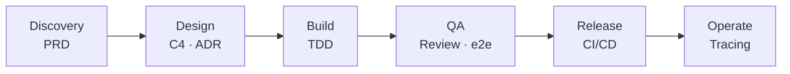

### Hi, I'm Dat 👋

Backend engineer turned AI engineer. I build production Java/Spring systems and bring LLM agents into real software, beyond the demo.

---

### 🏆 Highlights

| Contributions (last 12 months) | Pull requests | Course stars | Microservices built |
|:---:|:---:|:---:|:---:|
| **4.6k** | **358** | **99** | **6** |

---

### 🛠 What I build

<table>
<tr>
<td valign="top" width="50%">

**🤖 AI engineering**

- [**second-brain**](https://github.com/trinhvandat/second-brain) — LLM Wiki knowledge base over MCP, no vector DB
- [**super-memory-plugin**](https://github.com/trinhvandat/supper-memory-pluggin) — persistent product memory for Claude Code
- [**shipwithai-plugins**](https://github.com/ShipWithAI/shipwithai-plugins) — Claude Code plugins (team)
- [**Claude Code Mastery**](https://course.shipwithai.io) — free course, 55 modules, EN + VI · co-author

</td>
<td valign="top" width="50%">

**🏗 Backend engineering**

- [**Mangala Wallet**](https://github.com/MangalaLabs/mangala-wallet) — 6 microservices: gateway, auth, wallet, price, crawler, portfolio
- [**mangala-architecture**](https://github.com/trinhvandat/mangala-architecture) — C4 diagrams and ADRs
- [**passkey-webauthn**](https://github.com/trinhvandat/passkey-webauthn) — passwordless auth with Spring Boot and React

</td>
</tr>
</table>

<!-- TODO: add once the repo exists
- [**spring-ai-agent**](https://github.com/trinhvandat/spring-ai-agent) — production AI agent in Spring Boot: tool calling, evals, tracing
-->

---

### 🧰 Tech stack

| Area | Tools |
|---|---|
| **Backend** | Java · Kotlin · Spring Boot · Spring Cloud Gateway |
| **Data** | PostgreSQL · MongoDB · Redis · Kafka |
| **Infra** | Docker · GitHub Actions · Pulumi |
| **AI** | Claude API · MCP · Spring AI · Agents · Evals |
| **Learning** | LangChain4j · OpenTelemetry · Kotlin Multiplatform |

---

### 🚀 How I ship

AI-assisted at every step with Claude Code.
<!-- TODO: link the packaged skills once public: [sdlc-workflow](https://github.com/trinhvandat/sdlc-workflow) -->

---

<!-- TODO: enable with blog-post-workflow once the blog RSS feed is set
### ✍️ Latest writing

BLOG-POST-LIST:START
BLOG-POST-LIST:END

---
-->

### 📫 Let's connect

Open to talks about backend architecture, production AI, and AI-native engineering teams.
Reach me on [LinkedIn](https://www.linkedin.com/in/leonard-trinh/) or at [trinhvandat90399@gmail.com](mailto:trinhvandat90399@gmail.com).
